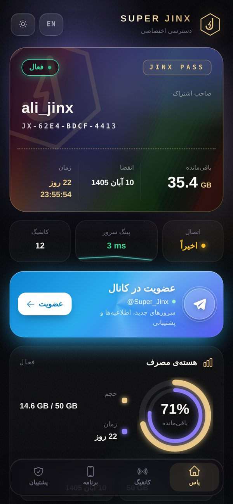
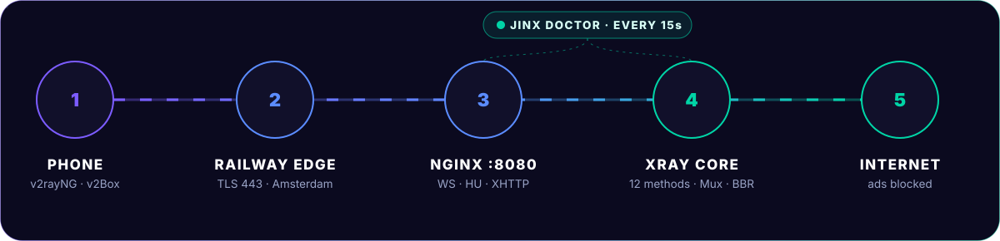

<div align="center">



[English](README.md) | **فارسی** | [Русский](README.ru_RU.md) | [中文](README.zh_CN.md)

<br/>


<br/><br/>

# جینکس | 𝗝𝗶𝗻𝗫

**پنل مرزبان روی Railway، رایگان و یک‌کلیکی**<br/>
بدون سرور، بدون دامنه، بدون سرتیفیکیت. پنج دقیقه نصب و اولین ساب‌لینک آماده‌ست.

<br/>

<a href="https://t.me/Super_Jinx"></a>
<a href="https://github.com/x4gpanell"></a>


<br/><br/>


</div>

<div dir="rtl">

## معرفی

**سوپر جینکس** پنل رسمی [مرزبان](https://github.com/Gozargah/Marzban)، nginx و [Xray-core](https://github.com/XTLS/Xray-core) رو توی یه سرویس Railway کنار هم می‌ذاره. همه‌چی پشت یه پورت کار می‌کنه، TLS رو خود Railway روی 443 می‌زنه و هر تنظیمی که معمولاً ترمینال لازم داره از قبل انجام شده.

علاوه بر خود مرزبان، ۱۲ روش اتصال آماده، پنل نمایندگی با محدودیت‌های سمت سرور، صفحه‌ی ساب اختصاصی، ربات خودترمیم، اینباند قفل‌شده‌ای که از داخل پنل خراب نمیشه و رابط کاملاً ترجمه‌شده داره.

## فهرست

- [ویژگی‌ها](#fa-1)
- [تصاویر](#تصاویر)
- [نصب سریع](#نصب-سریع)
- [معماری](#معماری)
- [روش‌های اتصال](#fa-2)
- [پنل نمایندگی](#پنل-نمایندگی)
- [صفحه‌ی ساب](#fa-3)
- [خودترمیمی](#خودترمیمی)
- [امنیت](#امنیت)
- [مسیرهای اختیاری](#مسیرهای-اختیاری)
- [متغیرها](#متغیرها)
- [لوکیشن‌ها](#fa-4)
- [اپ‌های پیشنهادی](#fa-5)
- [عیب‌یابی](#fa-6)
- [حمایت مالی](#حمایت-مالی)
- [کانال](#کانال)

<p align="center"></p>

<a name="fa-1"></a>

## ویژگی‌ها


- **نصب یک‌کلیکی** روی Railway، ورود اول با `admin / admin` و تغییرش از منوی پنل
- **۱۲ روش اتصال مستقیم** روی VLESS، VMess، Trojan، HTTPUpgrade و XHTTP، هر کدوم با اثر انگشت TLS و فرگمنت خودش
- **Reality اختیاری** با TCP Proxy و کانفیگ‌های **Mirror** روی دامنه‌های اضافه
- **بهینه برای سرعت**: Mux، BBR، Heartbeat، Early Data، بستن QUIC و ساب JSON کامل
- **پنل نمایندگی** با ویزارد ساخت، پکیج آماده و محدودیت‌های سمت سرور
- **صفحه‌ی ساب JinX Pass** با چیدمان جدا برای کامپیوتر و موبایل، پینگ زنده و QR
- **ربات خودترمیم** که هر ۱۵ ثانیه همه‌ی اجزا رو چک می‌کنه و بکاپ روزانه می‌گیره
- **اینباند قفل‌شده**، قفل ورود بعد از ۱۰ رمز اشتباه و بستن تبلیغات روی سرور
- **چهار زبان** برای همه‌ی بخش‌های سوپر جینکس: فارسی، English، Русский، 中文

<p align="center"></p>

## تصاویر

<table>
<tr>
<td width="70%"></td>
<td width="30%"></td>
</tr>
<tr>
<td align="center"><sub>JinX Pass · کامپیوتر</sub></td>
<td align="center"><sub>JinX Pass · موبایل</sub></td>
</tr>
<tr>
<td></td>
<td></td>
</tr>
<tr>
<td align="center"><sub>حمایت مالی · کامپیوتر</sub></td>
<td align="center"><sub>حمایت مالی · موبایل</sub></td>
</tr>
</table>

<p align="center"></p>

## نصب سریع


| قدم | کار |
|:--:|---|
| ۱ | بالای همین صفحه **Star** و بعد **Fork** رو بزن |
| ۲ | توی [Railway](https://railway.com) برو `New Project` ← `Deploy from GitHub repo` و ریپوی خودت رو انتخاب کن |
| ۳ | `Settings` ← `Region` ← **EU West (Amsterdam)**، کمترین پینگ از ایران |
| ۴ | `Attach Volume` با مسیر **`/var/lib/marzban`** |
| ۵ | `Settings` ← `Networking` ← `Generate Domain` روی پورت **`8080`** |
| ۶ | مطمئن شو **Serverless / App Sleeping خاموشه** |
| ۷ | **Redeploy** |

<div align="center">

| آدرس پنل | یوزر | رمز |
|:--:|:--:|:--:|
| `https://<دامنه>.up.railway.app/dashboard/` | `admin` | `admin` |

</div>

> [!IMPORTANT]
> بعد از اولین ورود از منو گزینه‌ی **تغییر نام کاربری و رمز عبور** رو بزن. تغییر همون لحظه اعمال میشه و با Redeploy هم برنمی‌گرده.

<p align="center"></p>

## معماری



Railway روی پورت 443 خودش TLS می‌زنه و همه‌چی رو به nginx روی پورت **8080** می‌فرسته. nginx پنل، صفحه‌ی ساب و همه‌ی ترنسپورت‌های Xray رو از همین یه پورت پخش می‌کنه و ربات **JinX Doctor** هر ۱۵ ثانیه همه‌ی اجزا رو چک می‌کنه. هیچ سرتیفیکیتی لازم نیست و هیچ‌وقت هم منقضی نمیشه.

<p align="center"></p>

<a name="fa-2"></a>

## روش‌های اتصال



اسم همه‌ی کانفیگ‌ها با **جینکس | 𝗝𝗶𝗻𝗫** شروع میشه و بعدش اسم روش و پروتکل میاد.

| # | روش | پروتکل | اثر انگشت | توضیح |
|:--:|---|---|:--:|---|
| 1 | **Amsterdam Rocket** | JinX Core | chrome | مستقیم با سرعت کامل، اسمش با ریجن عوض میشه |
| 2 | **Ghost Anti-Filter** | JinX Core | chrome | فرگمنت قوی برای SNI فیلترشده |
| 3 | **Hyper Drive** | VLESS WS | firefox | Mux |
| 4 | **Swift Shield** | VLESS WS | chrome | فرگمنت سبک |
| 5 | **Vortex** | VMess WS | safari | سرعت کامل |
| 6 | **Trident** | Trojan WS | edge | Mux |
| 7 | **Ninja Stealth** | Trojan WS | randomized | فرگمنت قوی |
| 8 | **Lightning** | HTTPUpgrade | chrome | سبک‌ترین ترنسپورت، سرعت کامل |
| 9 | **Meteor** | HTTPUpgrade | ios | فرگمنت سبک |
| 10 | **Warp Speed** | XHTTP | chrome | HTTP/2، بیشترین سرعت دانلود |
| 11 | **Nebula** | HTTPUpgrade | firefox | Mux |
| 12 | **Quantum** | XHTTP | randomized | HTTP/2 با فرگمنت سبک |
| + | **Reality Pulse**، **Dark Matter** | Reality | chrome، firefox | با روشن کردن TCP Proxy |
| + | **Mirror** | JinX Core، HTTPUpgrade | chrome | دامنه‌های اضافه‌ی همین سرویس |

اگه نسخه‌ی Xray داخل ایمیج HTTPUpgrade یا XHTTP رو نداشته باشه، همون اسم‌ها روی WebSocket ساخته میشن و تعداد همیشه ۱۲ تا می‌مونه.

### بهینه‌سازی سرعت

همه‌ی این‌ها خودکار روشنن.

| قابلیت | کارش |
|---|---|
| **۱۶ هزار اتصال** | nginx برای هر worker تا ۱۶٬۳۸۴ اتصال قبول می‌کنه که پنل شلوغ هم کند نشه |
| **Mux** | اتصال‌های جدید از تونل باز رد میشن و هر بار تا هلند دست نمیدن |
| **BBR** | سرعت ثابت‌تر روی اینترنت موبایل، اگه سرور اجازه بده |
| **Heartbeat** | هر ۳۰ ثانیه یه پینگ کوچیک که اپراتور خط بیکار رو نبنده |
| **Early Data** | یه رفت‌وبرگشت کمتر سر هر اتصال |
| **بستن QUIC** | مرورگر و یوتیوب روی TCP میرن که داخل تونل روون‌تره |
| **تست پینگ http** | اپ‌های sing-box و Clash با یه رفت‌وبرگشت کمتر تست می‌گیرن |
| **ساب JSON کامل** | v2rayNG، v2rayN، Streisand و Happ فرگمنت و Mux رو واقعاً اعمال می‌کنن |

> [!TIP]
> پینگ واقعی، بدون عدد فیک. توی v2rayNG یا V2Box آدرس تست رو بذار `http://cp.cloudflare.com/` و تست گروهی بگیر. صفحه‌ی ساب هم بهترین کانفیگ رو پیشنهاد میده.

### Reality

ترافیک Reality بدون واسطه‌ی وب Railway رد میشه و کمترین سربار رو داره.

1. `Settings` ← `Networking` ← **TCP Proxy** با پورت **`2010`**
2. **Redeploy**. دو کانفیگ **Reality Pulse** و **Dark Matter** خودشون به همه‌ی ساب‌ها اضافه میشن.

<p align="center"></p>

## پنل نمایندگی

از منو گزینه‌ی **پنل‌های نمایندگی** رو بزن. این گزینه فقط برای مدیر اصلیه.

| بخش | توضیح |
|---|---|
| **پکیج آماده** | برنزی `10 · 100GB · 30d`، نقره‌ای `50 · 500GB · 30d`، طلایی `100 · 1TB · 30d`، الماس `500 · 5TB · 90d`، سفارشی |
| **چک زنده** | یوزر تکراری و محدودیت اشتباه همون لحظه نشون داده میشه |
| **رمز قوی** | ساخت رمز ۱۴ کاراکتری با نوار قدرت |
| **پیش‌نمایش و تحویل** | کارت زنده، کپی جدا برای هر مورد، کپی همه و اشتراک‌گذاری |
| **شارژ و تمدید** | حجم، روز و ظرفیت کاربر در یک مرحله |
| **تاریخچه** | همه‌ی کارهای نماینده با تاریخ و ساعت |
| **محدودیت سمت سرور** | تعداد کاربر، حجم و تاریخ دور زده نمیشه |

نماینده‌ها از **`https://<دامنه>/agent/`** وارد میشن و پیام «به پنل نمایندگی خوش آمدید» رو می‌بینن. با حذف نماینده، کاربرهاش پاک نمیشن و به حساب مدیر اصلی منتقل میشن.

<p align="center"></p>

<a name="fa-3"></a>

## صفحه‌ی ساب

- کارت عضویت نورانی با حجم، تاریخ و وضعیت
- چیدمان جدا برای **کامپیوتر** و **موبایل**
- پینگ زنده کنار هر کانفیگ و کانفیگ پیشنهادی
- افزودن یک‌کلیکی برای Android، iOS و Windows
- کپی مطمئن، QR داخلی، کپی همه و دانلود فایل کانفیگ‌ها
- دستیار **JinX Care** که ساعت گوشی، اینترنت، سرور و پینگ رو چک می‌کنه
- تم تیره و روشن، فارسی و English
- بدون هیچ اتصال خارجی

<p align="center"></p>

## خودترمیمی

| اگه این خراب شه | JinX Doctor این کار رو می‌کنه |
|---|---|
| nginx | دوباره روشنش می‌کنه |
| هسته‌ی Xray | هر ۶۰ ثانیه یه اتصال واقعی تست می‌کنه و در صورت نیاز ری‌استارت می‌کنه |
| پنل جواب نده | کل سرویس رو تمیز بالا میاره |
| کانفیگ Xray خراب | بکاپ می‌گیره و از نو می‌سازه |
| ساب‌لینک‌ها | هر ۲۰ ثانیه درستشون نگه می‌داره |
| صفحه‌ی ساب یا حمایت مالی | از نسخه‌ی سالم برمی‌گردونه |
| دیتابیس | بکاپ روزانه، ۷ نسخه‌ی آخر |

> با گذاشتن `DOCTOR_TG_TOKEN` و `DOCTOR_TG_CHAT` هشدارها توی تلگرام میاد: تعمیرها، حجم و انقضای نماینده‌ها و رمزهای اشتباه پشت سر هم.

<p align="center"></p>

## امنیت

| | |
|---|---|
| **یوزر و رمز** | از منو عوض میشه، همون لحظه اعمال میشه و با Redeploy برنمی‌گرده |
| **قفل ورود** | ۱۰ رمز اشتباه، ورود ۵ دقیقه بسته میشه. قفل سمت سرور روی IP و یوزره |
| **اینباند قفل‌شده** | Core Settings فقط‌خواندنیه، کانفیگ Xray با هر استارت از نو ساخته میشه و هاست‌ها ظرف ۲۰ ثانیه برمی‌گردن |
| **ماندگاری دیتا** | دیتابیس، کاربرها و نماینده‌ها روی Volume می‌مونن |

<p align="center"></p>

## مسیرهای اختیاری

<details>
<summary><b>رله‌ی سرور ایران</b></summary>

<br/>

```
Client  ──►  Iran VPS :443  ══ TLS passthrough ══►  Railway
```

روی سرور ایران (Ubuntu یا Debian):

```bash
sudo bash iran-relay.sh xxxx.up.railway.app
```

بعد توی Railway متغیر `IRAN_RELAY_IP=آی‌پی_سرور` رو بذار و Redeploy بزن.

</details>

<details>
<summary><b>تانل کلودفلر</b></summary>

<br/>

1. یه دامنه به Cloudflare وصل کن.
2. `Zero Trust` ← `Networks` ← `Tunnels` ← `Create a tunnel` (نوع Cloudflared) و توکن رو کپی کن.
3. یه Public Hostname با سرویس `HTTP` ← `127.0.0.1:8080` بساز.
4. این متغیرها رو بذار و Redeploy بزن:

```env
CF_TUNNEL_TOKEN=توکن
CF_TUNNEL_HOSTNAME=jinx.example.com
CF_CLEAN_IP=آی‌پی تمیز (اختیاری)
```

</details>

<p align="center"></p>

## متغیرها

همه‌ی متغیرها اختیاری‌ان.

<details>
<summary><b>جدول کامل</b></summary>

<br/>

| متغیر | پیش‌فرض | توضیح |
|---|---|---|
| `PANEL_DOMAIN` | | دامنه‌ی شخصی |
| `RESET_ADMIN_PASSWORD` | | `1` = ورود برمی‌گرده روی `admin / admin`، بعدش پاکش کن |
| `SUB_UPDATE_INTERVAL` | `6` | هر چند ساعت اپ‌ها ساب رو آپدیت کنن |
| `DOCTOR_TG_TOKEN`، `DOCTOR_TG_CHAT` | | هشدارهای تلگرام |
| `TELEGRAM_API_TOKEN`، `TELEGRAM_ADMIN_ID` | | ربات تلگرام خود مرزبان |
| `CF_TUNNEL_TOKEN`، `CF_TUNNEL_HOSTNAME` | | تانل کلودفلر |
| `CF_CLEAN_IP`، `CF_PORTS` | `443,2053,8443` | Clean IPها و پورت‌ها |
| `IRAN_RELAY_IP`، `IRAN_RELAY_PORT` | `443` | رله‌ی ایران |
| `JINX_EXTRA_DOMAINS` | | دامنه‌های اضافه، برای هر کدوم یه کانفیگ Mirror |
| `JINX_REALITY_SNI` | `www.speedtest.net` | سایت پوششی Reality |
| `JINX_FRAGMENT` | `10-20,10-20,tlshello` | فرگمنت قوی، خالی = خاموش |
| `JINX_FRAGMENT_LIGHT` | `100-200,1-3,tlshello` | فرگمنت سبک |
| `JINX_MUX`، `JINX_BBR`، `JINX_ADBLOCK`، `JINX_FAST`، `JINX_REALITY` | `1` | `0` = خاموش |
| `JINX_HEARTBEAT` | `30` | ثانیه، `0` = خاموش |
| `USE_CUSTOM_JSON_FOR_V2RAYNG` | `True` | ساب JSON کامل برای v2rayNG، v2rayN، Streisand و Happ |

</details>

<p align="center"></p>

<a name="fa-4"></a>

## لوکیشن‌ها

| ریجن Railway | وضعیت |
|---|:--:|
| **EU West · Amsterdam** | پیشنهادی |
| US East · Virginia | پشتیبانی میشه |
| US West · California | پشتیبانی میشه |
| Southeast Asia · Singapore | پشتیبانی میشه |

برای چند لوکیشن، برای هر ریجن یه سرویس جدا با همین ریپو بساز.

<a name="fa-5"></a>

## اپ‌های پیشنهادی

| Android | iOS | Windows / macOS |
|:--:|:--:|:--:|
| v2rayNG · Hiddify · NekoBox | Streisand · V2Box · Hiddify | v2rayN · Hiddify · Clash Verge |

Mux رو خود ساب تنظیم می‌کنه، توی اپ دستی روشنش نکن. بعد از هر تغییر **Update Subscription** بزن.

<p align="center"></p>

<a name="fa-6"></a>

## عیب‌یابی

<details><summary><b>کانفیگ‌ها بعد از یه مدت قطع میشن</b></summary><br/>Serverless / App Sleeping رو از تنظیمات سرویس خاموش کن.</details>

<details><summary><b>دیپلوی روی Healthcheck فیل میشه</b></summary><br/>پورت دامنه باید <code>8080</code> باشه. لاگ <code>alembic</code> و <code>main.py</code> رو ببین.</details>

<details><summary><b>رمز یادم رفته</b></summary><br/>متغیر <code>RESET_ADMIN_PASSWORD=1</code> رو بذار، Redeploy بزن، با <code>admin / admin</code> وارد شو و بعد متغیر رو پاک کن.</details>

<details><summary><b>بعد از Redeploy کاربرها می‌پرن</b></summary><br/>Volume روی <code>/var/lib/marzban</code> وصل نیست.</details>

<details><summary><b>ساب‌لینک <code>{SERVER_IP}</code> میده</b></summary><br/>۲۰ ثانیه صبر کن و ساب رو آپدیت کن، نگهبان خودش درستش می‌کنه.</details>

<details><summary><b>کانفیگ مستقیم وصل نمیشه</b></summary><br/>Ghost Anti-Filter، Ninja Stealth یا Swift Shield رو امتحان کن. اگه نشد، Reality یا تانل کلودفلر.</details>

<details><summary><b>ذخیره‌ی Core Settings ارور 403 میده</b></summary><br/>عمدیه. اینباندها قفلن تا پنل هیچ‌وقت خراب نشه.</details>

<details><summary><b>پینگ بالاست</b></summary><br/>ریجن رو روی Amsterdam بذار، آدرس تست اپ رو <code>http://cp.cloudflare.com/</code> کن و Lightning یا Reality رو بزن.</details>

<p align="center"></p>

## حمایت مالی

دکمه‌ی **حمایت مالی** بالای پنل صفحه‌ی `https://<دامنه>/donate/` رو باز می‌کنه. هر آدرس قبل از نمایش با چک‌سام شبکه‌ی خودش بررسی میشه، QR روی همون دستگاه ساخته میشه و صفحه هیچ اتصال خارجی نداره. برای گذاشتن آدرس‌های خودت فقط `donate-config.js` رو ویرایش کن.

## کانال

آخرین آپدیت‌ها، آموزش‌ها و پشتیبانی توی کانال تلگرام.

<div align="center">

<a href="https://t.me/Super_Jinx"></a>
<a href="https://github.com/x4gpanell"></a>

<br/><br/>

اگه سوپر جینکس به کارت اومد، یه ستاره بده.

<sub>ساخته شده بر پایه‌ی <a href="https://github.com/Gozargah/Marzban">Marzban</a> (AGPL-3.0) و <a href="https://github.com/XTLS/Xray-core">Xray-core</a></sub>


</div>

</div>
